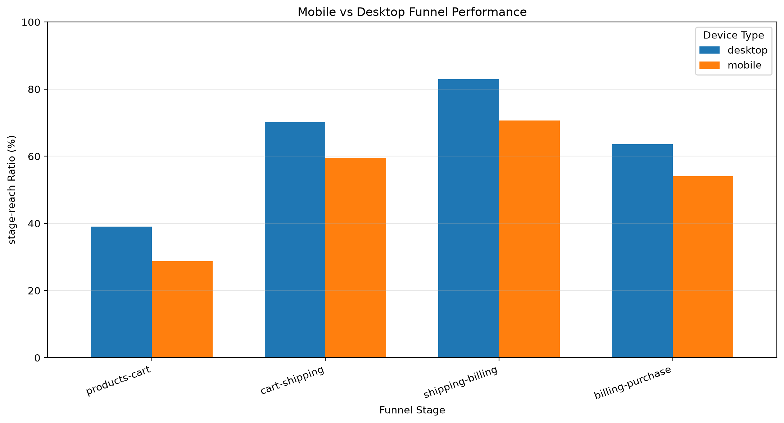

# Maven Fuzzy Factory | E-Commerce Conversion Optimization

## 1. Project Overview

An end-to-end e-commerce analytics project using **PostgreSQL, Python, Pandas, Jupyter Notebook, Matplotlib, and Tableau** to analyze website performance, investigate customer purchasing behavior, and identify conversion optimization opportunities.

**Business Problem:** Why do visitors abandon the purchase process, and which areas of the website should the business prioritize to improve conversion?

**Analysis Period:** March 2012 – March 2015

### Project Objectives

- Analyze website traffic and purchase conversion.
- Evaluate marketing sources and landing-page performance.
- Investigate customer behavior across the conversion funnel.
- Compare mobile and desktop purchasing journeys.
- Identify potential conversion improvement opportunities.

## 2. Tools and Technologies

| Technology | Application |
|---|---|
| PostgreSQL | SQL analysis, joins, CTEs, aggregations, business KPIs |
| Python | Analytical programming and data processing |
| Pandas | Data validation, cleaning checks, transformation, grouping, merging, conversion analysis |
| Jupyter Notebook | Organizing and documenting the Python analysis |
| SQLAlchemy & Psycopg | Connecting Python to PostgreSQL |
| Matplotlib | Data visualization |
| Tableau | Interactive business dashboard |
| Git & GitHub | Version control and portfolio documentation |

## 3. Business Performance Overview

| KPI | Result |
|---|---:|
| Total Website Sessions | 472,871 |
| Total Orders | 32,313 |
| Overall Conversion Rate | 6.83% |
| Total Order Revenue | $1,938,509.75 |

Revenue represents recorded order revenue before refunds.

## 4. PostgreSQL — SQL Business Analysis

SQL was used to investigate the overall performance of the e-commerce website.

### Analyses Performed

- Data profiling and table relationship analysis
- Overall website conversion performance
- Mobile versus desktop conversion analysis
- New versus returning visitor performance
- Marketing campaign and traffic-source analysis
- Landing-page conversion analysis
- Website purchase funnel analysis
- Product revenue and profitability analysis

### Important SQL Findings

- Desktop conversion: **8.50%**
- Mobile conversion: **3.09%**
- Highest-converting landing page: **/lander-5 — 10.17%**
- Lowest-converting landing page: **/lander-3 — 3.39%**
- Overall product-to-cart progression: **36.35%**

These results helped identify the business problems investigated further using Python and Pandas.

## 5. Python, Pandas & Jupyter Notebook — Data Validation and Deeper Analysis

**Notebook:** `01_data_exploration.ipynb`

Python and Pandas were used to validate the existing e-commerce data, create session-level analytical datasets, compare customer behavior, and prepare visualizations and Tableau-ready outputs.

The analysis was developed and documented in Jupyter Notebook using VS Code.

### 5.1 Database Integration

Connected Python to the existing PostgreSQL database using **SQLAlchemy and Psycopg**.

Used `pd.read_sql()` to retrieve selected columns from:

- `website_sessions`
- `website_pageviews`
- `orders`

The retrieved data was stored in Pandas DataFrames for further processing.

### 5.2 Data Quality Validation

Performed validation checks using Pandas before continuing the funnel analysis.

**Checks performed:**

- Missing-value checks using `isna().sum()`
- Duplicate primary-ID checks using `duplicated().sum()`
- Session relationship validation using `isin()`
- Record-count reconciliation with PostgreSQL
- Checkout page URL verification using `value_counts()` and `str.contains()`

**Results:**

- No missing values in the selected analytical columns.
- No duplicate primary identifiers in the analyzed tables.
- No pageviews or orders referencing unknown website sessions.
- 32,313 purchasing sessions identified, matching the source data.

### 5.3 Data Transformation Using Pandas

Created a session-level funnel dataset using Pandas operations rather than repeating the main SQL aggregation queries.

**Key transformations:**

- Used `isin()` to identify relevant funnel pageviews.
- Used `map()` to assign page URLs to funnel stages.
- Combined `/billing` and `/billing-2` into a common billing stage.
- Used `pd.crosstab()` to identify which stages each session reached.
- Used `merge()` to connect funnel information with device types.
- Used `fillna()` to handle missing funnel-stage indicators.
- Matched orders to sessions to identify purchases.
- Used `groupby()` and `sum()` to calculate funnel-stage counts by device.

These transformations created the foundation for comparing mobile and desktop purchasing behavior.

### 5.4 Mobile vs Desktop Funnel Analysis

Calculated progression ratios directly in Pandas using DataFrame column operations, loops, and percentage calculations.

| Funnel Stage | Desktop | Mobile | Difference |
|---|---:|---:|---:|
| Products → Cart | 39.08% | 28.73% | 10.35 pp |
| Cart → Shipping | 70.11% | 59.56% | 10.55 pp |
| Shipping → Billing | 82.98% | 70.69% | 12.29 pp |
| Billing → Purchase | 63.59% | 54.08% | 9.51 pp |

**Key findings:**

- Mobile sessions showed lower progression ratios at every measured stage.
- Products to Cart had the lowest progression ratio for both devices.
- Shipping to Billing showed the largest desktop–mobile gap at 12.29 percentage points.

### 5.5 Additional Pandas Analysis

Prepared additional analytical datasets for the Tableau dashboard.

**Landing Page Performance**

- Identified the first pageview of each session using `sort_values()` and `drop_duplicates()`.
- Linked landing sessions to purchases.
- Calculated sessions, purchasing sessions, and conversion rates using `groupby()` and `agg()`.

**Marketing Source Performance**

- Identified purchasing sessions for each marketing source.
- Handled missing marketing-source values using `fillna()`.
- Calculated marketing-source conversion rates and traffic volumes.

**Business KPI Preparation**

- Loaded database-wide KPI results into Pandas.
- Calculated overall conversion rate and average order value.
- Exported the KPI summary for Tableau.

### 5.6 Data Visualization with Matplotlib

Created a grouped bar chart comparing desktop and mobile funnel performance.

The visualization highlights conversion differences across the four measured funnel stages.



### 5.7 Exporting Analytical Datasets

Exported the processed analytical results using Pandas `to_csv()`.

The generated files include:

- `business_kpi_summary.csv`
- `device_funnel_counts.csv`
- `device_funnel_comparison.csv`
- `landing_page_performance.csv`
- `marketing_source_performance.csv`

These datasets were used to create Tableau visualizations.

## 6. Tableau — Interactive Dashboard

Developed and published an interactive Tableau dashboard combining the SQL findings and Pandas analytical outputs.

### Dashboard Components

**Business KPIs**
- Total Sessions
- Total Orders
- Overall Conversion Rate
- Total Revenue

**Analytical Visualizations**
- Mobile vs Desktop Funnel Performance
- Device Conversion Gap
- Landing Page Conversion Performance
- Marketing Source Conversion Performance

### Live Dashboard

[View E-Commerce Conversion Optimization Dashboard on Tableau Public](https://public.tableau.com/app/profile/naveen.chunduri/viz/Book1_17936724814300/E-CommerceConversionOptimization)

## 7. Key Business Findings

**Finding 1 — Mobile Conversion Gap**

Desktop visitors converted more frequently than mobile visitors, with an overall conversion rate of 8.50% compared with 3.09%.

**Finding 2 — Product-to-Cart Engagement**

Product-to-cart progression was relatively low for both devices, especially mobile.

**Finding 3 — Checkout Performance**

Shipping to Billing had the largest observed device-performance gap, suggesting a potential area for mobile checkout investigation.

**Finding 4 — Landing Page Differences**

Landing pages showed substantial differences in conversion performance, with `/lander-5` outperforming `/lander-3` in the observed data.

## 8. Business Recommendations

1. **Investigate mobile checkout usability:** Review the shipping and billing journey for potential form, navigation, or technical friction.
2. **Evaluate product-page engagement:** Examine product descriptions, add-to-cart visibility, and mobile usability.
3. **Review landing-page differences:** Investigate traffic composition and customer behavior across high- and low-converting pages.
4. **Assess marketing-source quality:** Compare conversion rates alongside traffic volumes and campaign characteristics.
5. **Test proposed changes:** Use controlled A/B experiments to evaluate whether improvements increase conversion rates.

## 9. Analysis Limitations

Funnel progression ratios compare sessions that reached different pages but do not enforce the chronological order of page visits. They are stage-reach ratios rather than strict sequential funnel conversion probabilities.

Observed performance differences identify associations and potential opportunities but do not establish the causes of abandonment.

## 10. Project Structure

```text
Maven_Fuzzy_Factory/
│
├── README.md
├── SQL Analysis File
├── 01_data_exploration.ipynb
├── .gitignore
│
└── outputs/
    ├── business_kpi_summary.csv
    ├── device_funnel_counts.csv
    ├── device_funnel_comparison.csv
    ├── device_funnel_comparison.png
    ├── landing_page_performance.csv
    └── marketing_source_performance.csv
```

The raw source datasets are excluded from the repository using `.gitignore`.

## 11. Conclusion

This project demonstrates an end-to-end business analytics workflow using SQL, Python, Pandas, Jupyter Notebook, Matplotlib, and Tableau.

PostgreSQL was used for comprehensive business performance analysis. Python and Pandas were used for data validation, session-level transformations, deeper conversion investigation, and analytical dataset preparation. Tableau was used to communicate the findings through an interactive business dashboard.

Together, these analyses highlight conversion performance differences across devices, landing pages, and marketing sources, supporting data-driven prioritization of potential website improvements.
